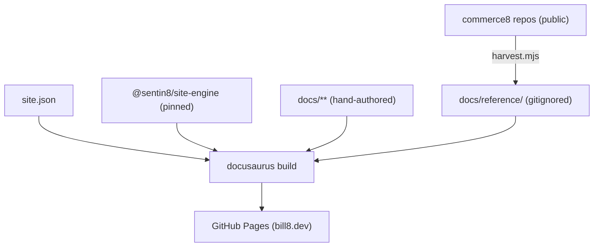

# README.md: Bill8:Site - bill8.dev

> The Bill8 public website at [bill8.dev](https://bill8.dev): every
> product, app, and SDK of the vertical, with its domain invariants
> and inherited security posture front and center. Built on
> `@sentin8/site-engine` (Docusaurus v3). Program design of record:
> `design/sentin8-websites-design.md` (WEB §4.5).

## 1. Summary

bill8.dev is the Bill8 vertical's product site: a landing page
detailing all six products and four apps, per-product
pages with use cases and API surfaces, the vertical's security
invariants, developer lifecycle, samples, and a **Reference** section
harvested at build time from each unit repo's own docs - the
repositories stay the source of truth.

## 2. Motivation

A platform team evaluating commerce needs the money guarantees up front: one balance authority, screened charges, signed webhooks, and deterministic proration. This site is that layer, harvested so marketing never drifts from the code.

## 3. Architecture



## 4. Content map

| Route | Content |
|---|---|
| `/` | Hero · product cards · apps · SDK · invariant pillars · platform showcase |
| `/docs/` | Vertical overview |
| `/docs/products/{unit}` | Per product: use cases · API surface |
| `/docs/apps/{app}` | Per app: purpose, what it demonstrates |
| `/docs/security/` | Vertical invariants + inherited platform pillars |
| `/docs/developers/` · `/docs/samples/` | Dev story · first calls |
| `/docs/reference/{unit}/` | Harvested README/DESIGN/BUSINESS per unit |

## 5. Development

```bash
npm install
npm run harvest   # renders docs/reference/ from sibling repos (offline)
npm start
npm run build     # fails on broken links
```

Adding a unit: edit `site.json` → add `docs/products/{slug}.md` →
the harvester picks up the repo trio automatically.

## 6. Deployment

Push to `main` → `ci.yml` calls `Sentin8/sentin8-ci site.yml@ci-v1` →
harvest → build → GitHub Pages. Weekly scheduled rebuild refreshes
harvested content. Custom domain via `static/CNAME` (operator DNS
step: WEB-10).

---

**Design attribution:** Bill8:Site and its underlying concepts were designed by Hamid Jahanzad <Hamid@Jahanzad.com>.
