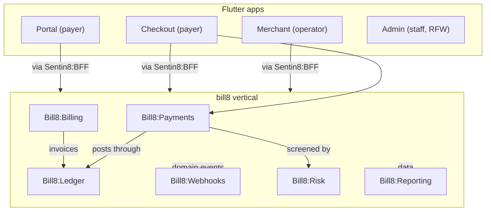

# Bill8 - the commerce vertical

Bill8 is billing and payments for platforms on Sentin8: merchants,
checkout, recurring billing, a double-entry money engine, signed
webhooks, fraud screening, and reporting - six Rust services, four
Flutter apps, and a unified Rust SDK. Money movement is delegated to
[Bank8:Payments](https://bank8.dev/docs/products/payments/); bill8
owns the commerce domain.

## The products

| Product | Role |
|---|---|
| [Payments](/docs/products/payments) | the charge lifecycle - intent to dispute |
| [Billing](/docs/products/billing) | recurring revenue - subscriptions, invoices, metering |
| [Ledger](/docs/products/ledger) | the money engine - one balance authority |
| [Webhooks](/docs/products/webhooks) | signed outbound event delivery |
| [Risk](/docs/products/risk) | fraud screening - rules, velocity, review queue |
| [Reporting](/docs/products/reporting) | report types, runs, scheduled delivery |

## Security

Bill8 inherits the platform's five pillars and adds commerce
guarantees: one money authority, screened charges, and signed
webhooks. Read the [security page](/docs/security).