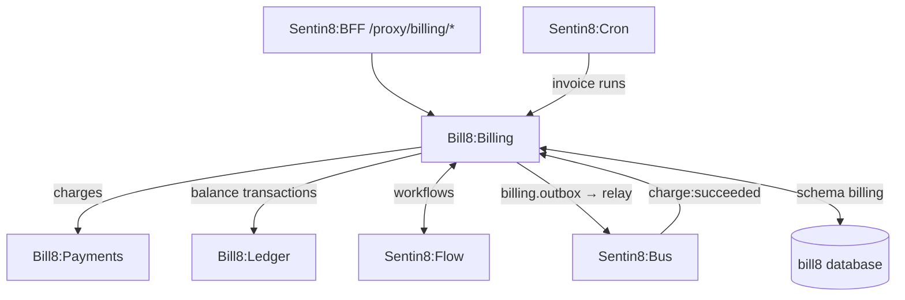
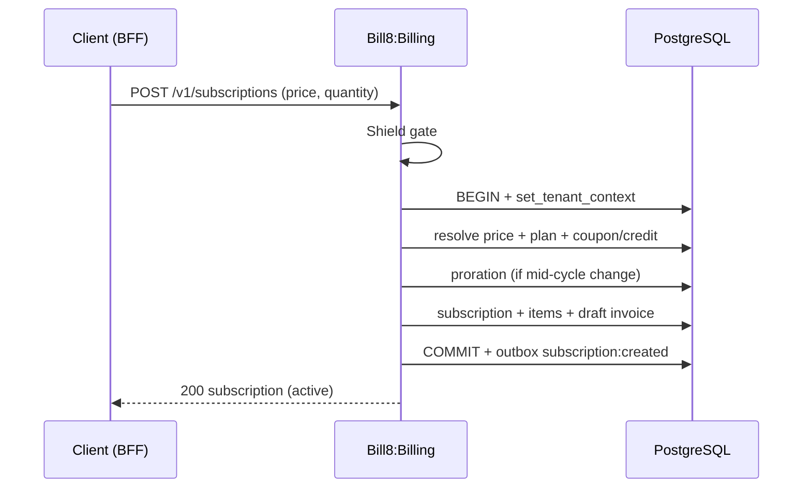
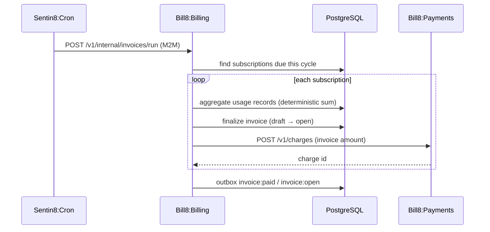
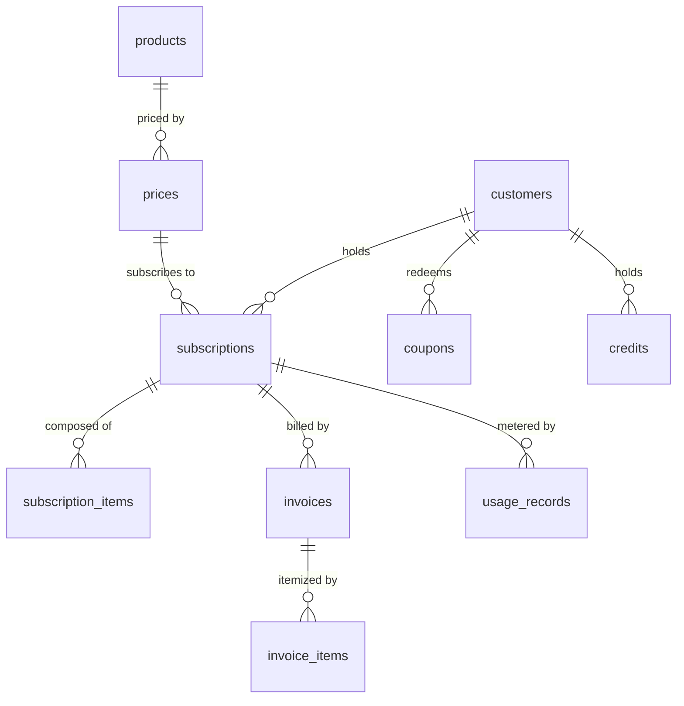
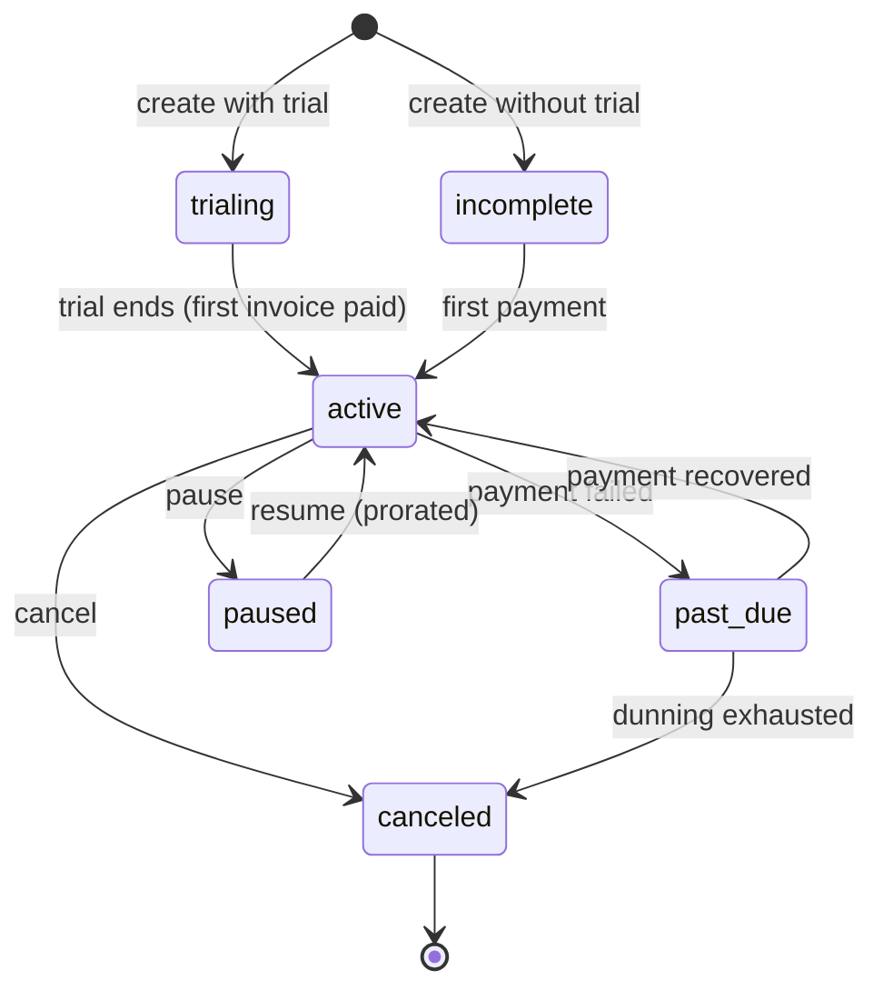
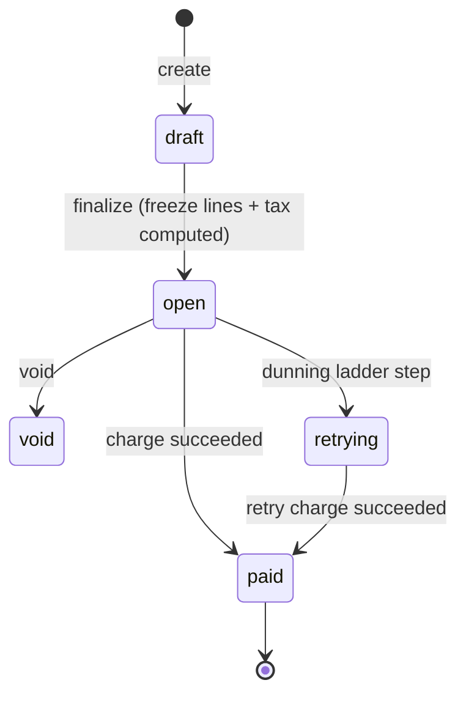
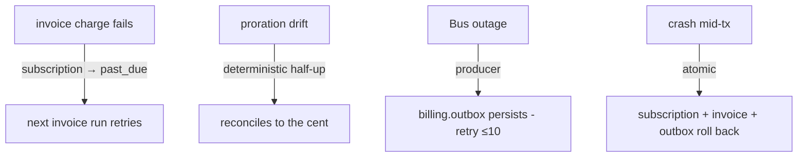
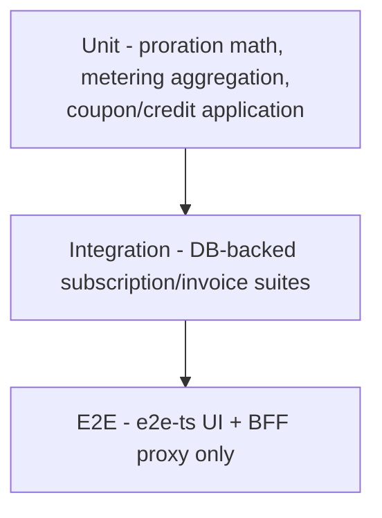

# Bill8:Billing - Detailed Design Document

## 1. Scope & Context

Bill8:Billing owns: the billing domain schema (domain tables + the
leaf schema `billing` for outbox/audit journal), the product / price /
subscription / invoice / usage-record / coupon / credit REST API, the
proration and metering engines, the invoice-run proxy-back handler for
Sentin8:Cron, and the `bill8:billing:*` event family.

It does NOT own: money movement (Bill8:Ledger), charge execution
(Bill8:Payments), workflow orchestration (Sentin8:Flow), or
scheduling (Sentin8:Cron - billing supplies the due-invoice execution).

Billing owns the **subscription lifecycle richness**: trials, billing
anchors, pause/resume, dunning - and the **invoice richness**:
pricing models (flat/tiered/volume/packaged usage), read-only previews
(upcoming invoice, proration quotes), credit notes (invoice-level
adjustments - charge-level refunds belong to payments), explicit tax
lines, and invoice PDF/email delivery (documents via Sentin8:Storage,
email via Sentin8:Post).

## 2. Runtime Architecture

Shell-booted; `build_state` adds config, Bus client, AppState, and a
consumer for `bill8:payments:charge:succeeded` (mark invoice paid).

**Subscription creation with proration**:

**Invoice run (Cron proxy-back)**:

## 3. Data Model

| Table | Purpose |
|---|---|
| `products` | Catalog of sellable things |
| `prices` | Recurring or one-off price points (pricing model on the price) |
| `subscriptions` | A customer's plan instance (trial_end, billing_cycle_anchor, paused state) |
| `subscription_items` | Quantified lines on a subscription |
| `invoices` | Generated bills |
| `invoice_items` | Line items on an invoice |
| `usage_records` | Metered consumption events |
| `coupons` | Discounts (percentage / amount) |
| `credits` | Prepaid value balances |
| `credit_notes` | Invoice-level adjustments (issued → void) |
| `tax_rates` | Jurisdiction tax rates (inclusive/exclusive) |
| `dunning_configs` | Per-env retry ladders for past-due invoices |

**Producer tables** (platform contracts, `billing` leaf schema):
`billing.outbox` (DBX producer path - architecture-principles §6.7) and
`billing.audit_journal` (the 15-column contract of
`sentin8_audit:: audit_journal_sql` - env-pinned RLS, drained
to Sys `POST /v1/audit` by the shell's boot-8c pusher).

**State machines**:

## 4. API Surface

| Endpoint group | Prefix | Authorization | Events |
|---|---|---|---|
| Products | `/v1/products` | `bill8:billing:products:{read,write}` | `product:created/updated` |
| Prices | `/v1/prices` | `bill8:billing:prices:{read,write}` | `price:created/updated` |
| Subscriptions | `/v1/subscriptions` | `bill8:billing:subscriptions:{read,write}` | `subscription:created/updated/canceled` |
| Subscription items | `/v1/subscription-items` | `bill8:billing:subscription-items:{read,write}` | `subscription_item:created/updated` |
| Invoices | `/v1/invoices` | `bill8:billing:invoices:{read,write}` | `invoice:created/paid/voided` |
| Usage records | `/v1/usage-records` | `bill8:billing:usage-records:write` | `usage_record:created` |
| Coupons | `/v1/coupons` | `bill8:billing:coupons:{read,write}` | `coupon:created/updated` |
| Credits | `/v1/credits` | `bill8:billing:credits:{read,write}` | `credit:created/updated` |
| Credit notes | `/v1/credit-notes`, `/v1/credit-notes/{id}/void` | `bill8:billing:credit-notes:{read,write}` | `credit_note:issued/voided` |
| Entitlements | `/v1/entitlements` | `bill8:billing:entitlements:read` | - |
| Previews | `/v1/invoices/upcoming`, `/v1/subscriptions/preview` | `bill8:billing:invoices:read` | - (read-only, zero writes) |
| Tax rates | `/v1/tax-rates` | `bill8:billing:tax-rates:{read,write}` | `tax_rate:created/updated` |
| Invoice document | `/v1/invoices/{id}/pdf` (signed link) | `bill8:billing:invoices:read` | `invoice:emailed` |
| Internal | `/v1/internal/*` | M2M | - |

**Dunning ladder** - a per-env retry schedule (`dunning_configs`):
each step re-charges the past-due invoice and notifies via
Sentin8:Post; the ladder is data (count, backoff), never ad hoc;
exhaustion cancels the subscription (guarded terminal transition).

## 5. Cross-Cutting Concerns

- Shield-gated; `env_id` RLS + holder scoping on customer-held tables.
- Cert-bound DCR (`billing`, `billing-policy`, `billing-audit`).
- Idempotency on invoice runs and usage-record aggregation.
- Consumes `charge:succeeded` to mark invoices paid (event-driven).

## 6. Failure Modes & Recovery

## 7. Concurrency & Performance Model

- Pool cap 3; usage aggregation is a single deterministic SUM per
  invoice, not per event.
- Invoice-run is cron-triggered and processes subscriptions in bounded
  batches.

## 8. Invariants, Insecure-Defaults Rejected, Unsafe Rationale

- Invoices immutable once finalized; only status transitions guarded.
- Proration nets to the cent (half-up).
- Subscription items sum to the billed amount.
- `#![forbid(unsafe_code)]`.

## 9. Testing Strategy

## 10. Open Questions

- See `backlog.md` `BIL-*`.

---

**Architecture & Design:** bill8:billing and its underlying concepts were designed by [Hamid Jahanzad](https://www.linkedin.com/in/hamidjahanzad/).

