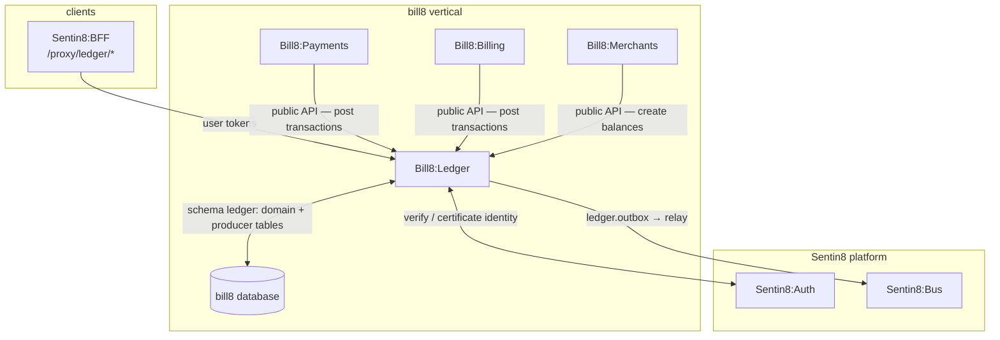
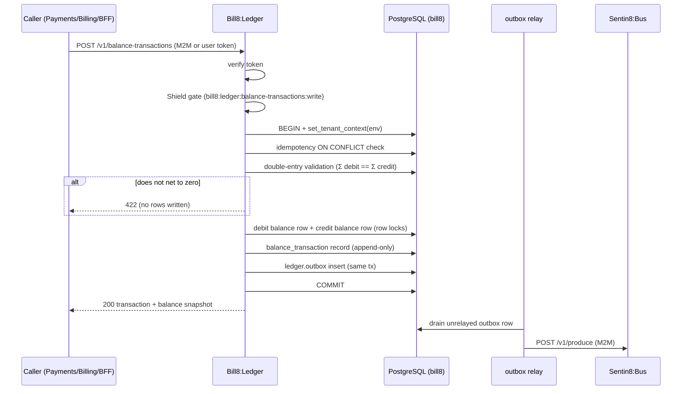
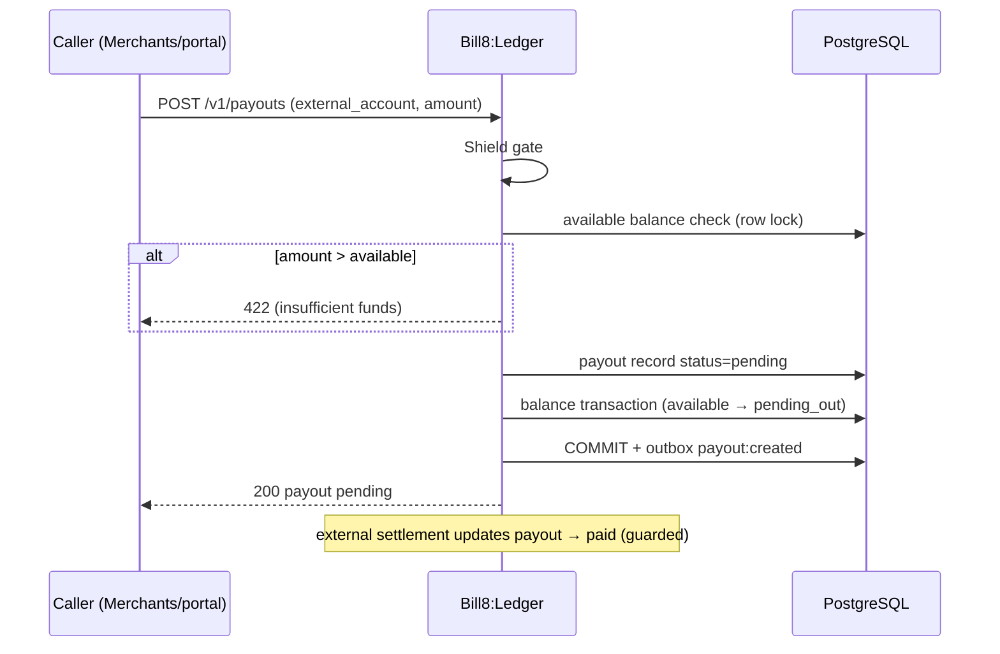
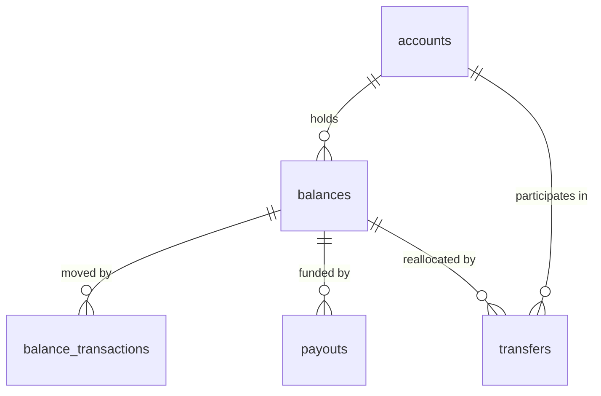
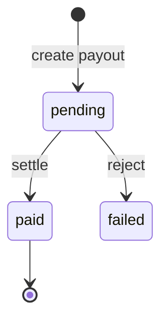
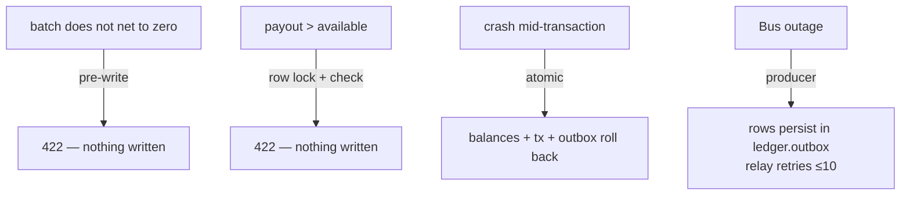
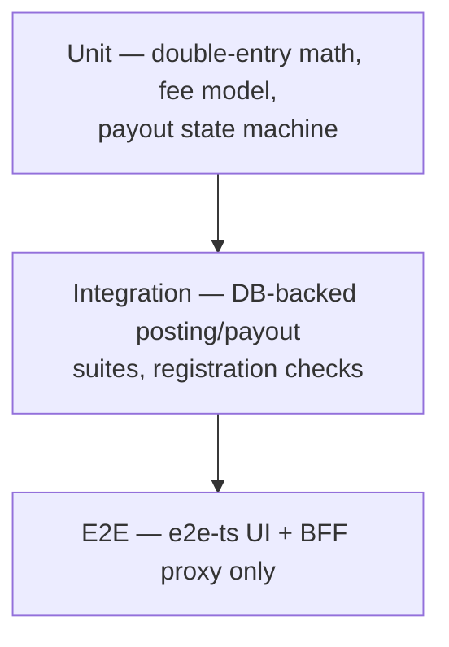

# Bill8:Ledger — Detailed Design Document

## 1. Scope & Context

Bill8:Ledger owns: the ledger domain schema in the bill8
vertical database (domain tables + the service leaf schema `ledger` for
the outbox and audit journal), the balance / balance-transaction /
payout / transfer REST API, the double-entry money engine, the
**multi-currency keying** (`(account, currency)` balances, explicit FX
batches), the **destination-charge posting rules** (split-at-charge
batches), the **payout schedule engine**, and the
`bill8:ledger:*` event family.

It does NOT own: payment orchestration (Bill8:Payments calls in to
post transactions), billing (Bill8:Billing calls in for invoice
movements), connected-account lifecycle (Bill8:Merchants creates
balances via the public API), or the fee *policy* — the ledger applies
the fee model as explicit balance transactions but the rate table is
configured by the vertical.

## 2. Runtime Architecture

Boot is shell-owned. `build_state` adds the ledger wiring: config, Bus
client, AppState, and the sys-family env-init consumer.

**Request lifecycle — balance transaction posting** (the canonical
family; every other handler is a subset):

**Payout lifecycle**:

## 3. Data Model

Domain tables in schema `ledger`, all `env_id`-scoped + FORCE-RLS; the
same schema carries the producer tables.

| Table | Purpose | RLS tier |
|---|---|---|
| `accounts` | Internal ledger accounts (customer / platform / connected) | env |
| `balances` | Named money positions per currency: `available`, `pending`, `connected_reserved`, `platform_fee` — keyed `(account_id, name, currency)` | env |
| `balance_transactions` | Append-only double-entry movements | env |
| `payouts` | Withdrawals to external accounts | env |
| `payout_schedules` | Automatic payout intervals (daily/weekly/monthly + minimum) | env |
| `transfers` | Internal movements between connected accounts | env |
| `fees` | Configured fee model (per-transaction + percentage) | env |
| `fx_rates` | Conversion rates; every conversion posts as an explicit batch with a spread fee | env |

**Multi-currency** — balances and movements are currency-keyed; a
balance transacts only in its own currency — cross-currency movement
is rejected pre-write (422, nothing written). Conversion between
currencies is an **explicit** double-entry batch (rate + spread fee
posted, never implicit), owned by the FX story.

**Destination-charge posting rules** — a split-at-charge
(`on_behalf_of` + `application_fee_amount`) is a single validated
batch: debit the payer's side, credit the connected account's
`available`, credit the platform `platform_fee` — Σ legs == charge
amount, net-zero enforced by the same pre-write check.

**State machine**:

## 4. API Surface

| Endpoint group | Prefix | Authorization | Events |
|---|---|---|---|
| Accounts | `/v1/accounts` | `bill8:ledger:accounts:{read,write}` | `account:created` |
| Balances | `/v1/balances` | `bill8:ledger:balances:{read,write}` | `balance:updated` |
| Balance transactions | `/v1/balance-transactions` | `bill8:ledger:balance-transactions:{read,write}` | `balance_transaction:created` |
| Payouts | `/v1/payouts` | `bill8:ledger:payouts:{read,write}` | `payout:created/updated` |
| Payout schedules | `/v1/payout-schedules` | `bill8:ledger:payout-schedules:{read,write}` | `payout_schedule:created/updated` |
| Transfers | `/v1/transfers` | `bill8:ledger:transfers:{read,write}` | `transfer:created` |
| Fees | `/v1/fees` | `bill8:ledger:fees:{read,write}` | `fee:updated` |
| Internal (proxy-back) | `/v1/internal/*` | M2M | — |

## 5. Cross-Cutting Concerns

- **Authorization**: Shield-gated; scope-mirror sets seeded at enroll.
- **Tenant isolation**: `env_id` RLS + explicit `WHERE env_id`.
- **M2M**: certificate identity per workload (CERTFREE-4V) (`ledger`, `ledger-policy`,
  `ledger-audit`).
- **Audit**: local `ledger.audit_journal` → Sys pusher.
- **Idempotency**: `(env_id, idempotency_key)` unique on postings.
- **TLS**: in-process PQ-TLS.

## 6. Failure Modes & Recovery

## 7. Concurrency & Performance Model

- Pool cap 3; row locks on balance rows serialize concurrent movements
  per balance (correctness over throughput).
- Double-entry validation is pure and runs before any write.

## 8. Invariants, Insecure-Defaults Rejected, Unsafe Rationale

- Every balance transaction nets to zero (Σ debit == Σ credit).
- Balance transactions are append-only; a balance is only ever mutated
  via a balance transaction.
- A balance transacts only in its own currency; every FX conversion is
  an explicit batch with a posted spread fee.
- No service other than the ledger writes balances; a settlement
  channel never mutates balances (payments DESIGN.md §2b).
- Destination-charge splits sum exactly to the charge amount.
- `#![forbid(unsafe_code)]`.
- Rejected: single-sided ledger rows; a shared superuser DSN; blanket
  schema grants.

## 9. Testing Strategy

## 10. Open Questions

- FX conversion and settlement currency per connected account are
  sequenced as two stories — presentment first (`LED-5a`), conversion
  after (`LED-5b`) — both at final target state when built; no phased
  rollouts (see `backlog.md`).

---

**Design attribution:** bill8:ledger and its underlying concepts were designed by Hamid Jahanzad <Hamid@Jahanzad.com>.

