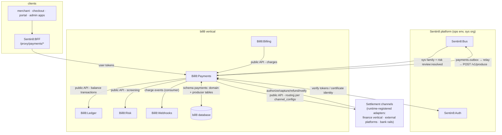
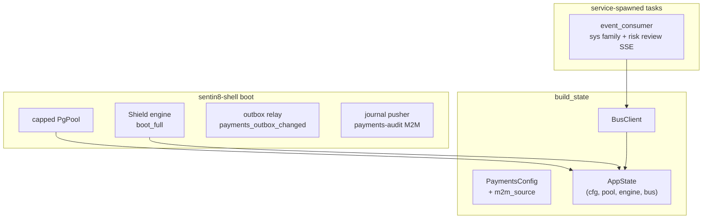
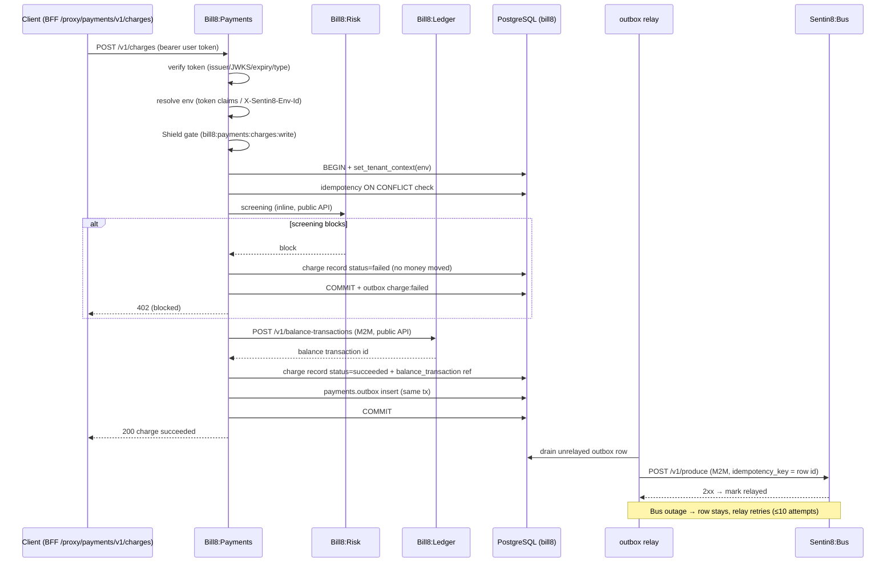
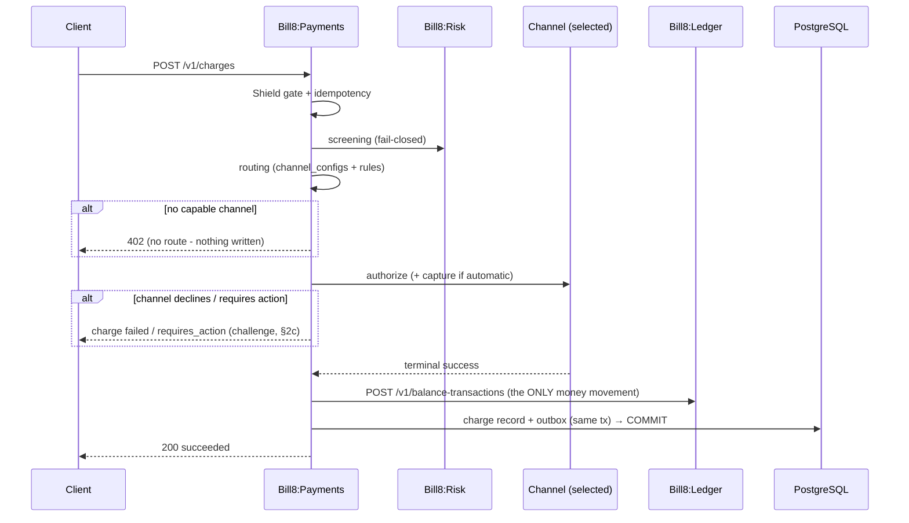
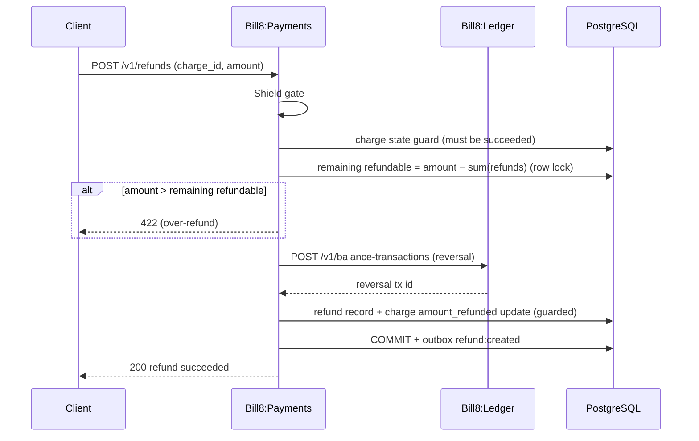
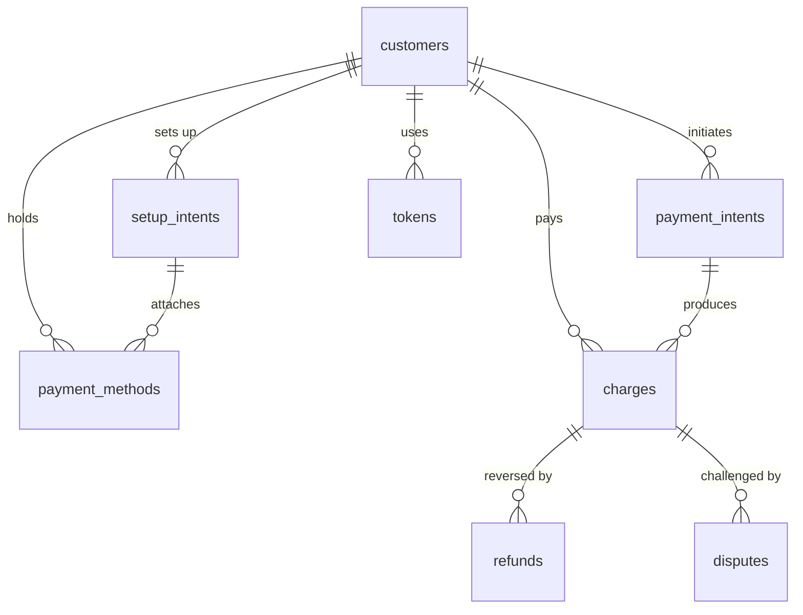
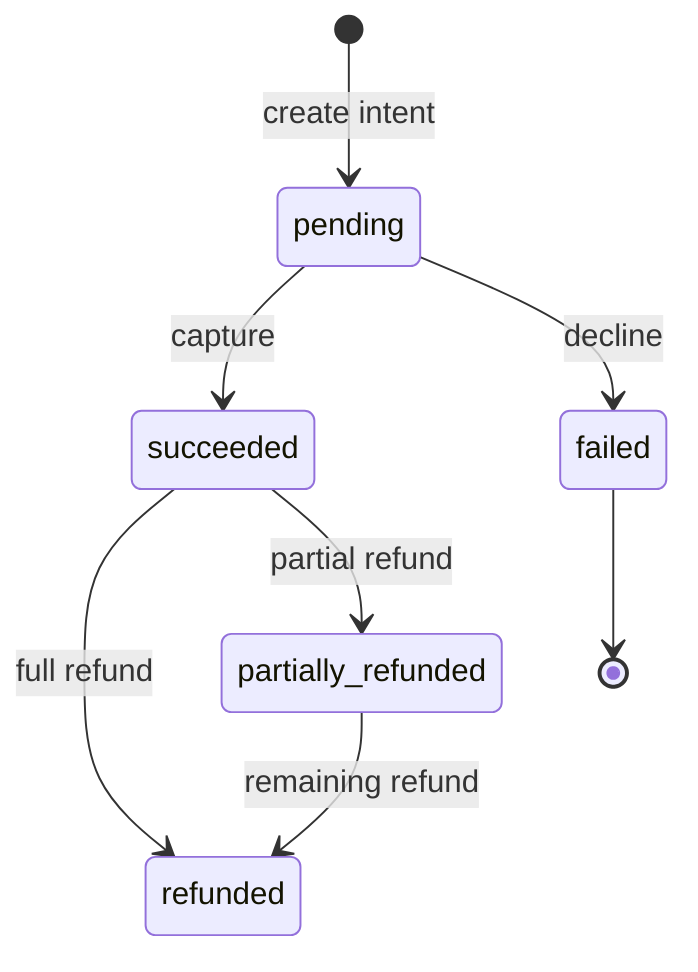
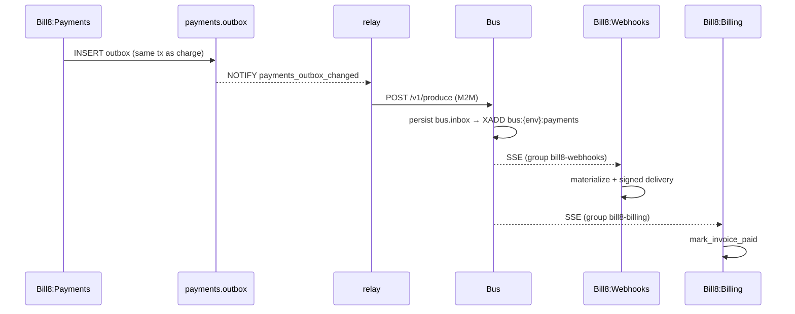
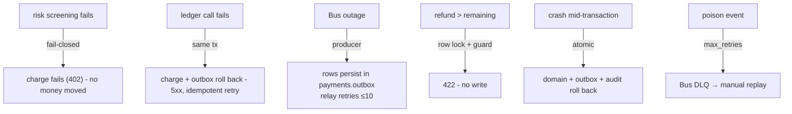
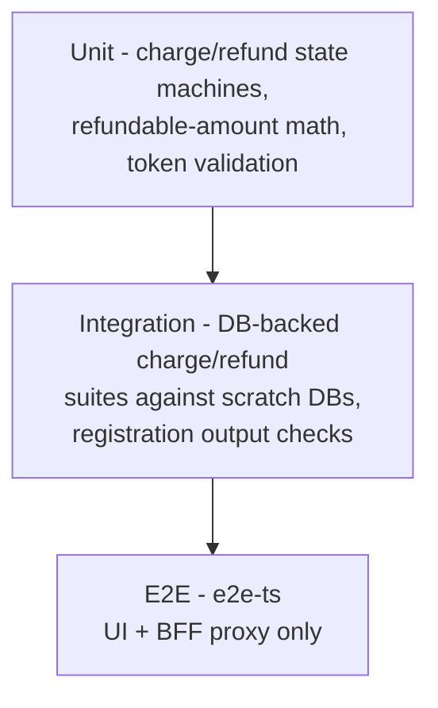

# Bill8:Payments - Detailed Design Document

## 1. Scope & Context

Bill8:Payments owns: the payments domain schema in the bill8
vertical database (domain tables + the service leaf schema `payments`
for the outbox and audit journal), the customer / payment-method /
intent / charge / refund / dispute REST API, the risk pre-authorization
integration, the **settlement-channel layer** (adapter contract,
runtime channel registry, routing rules, settlement reconciliation,
SCA challenge handback), and the `bill8:payments:*` event family.

It does NOT own: money movement (Bill8:Ledger - a channel never
mutates balances; only the ledger posting does), recurring billing
(Bill8:Billing), hosted checkout UI (Bill8:Checkout),
connected accounts (Bill8:Merchants), merchant API-key management
(Bill8:Merchants owns the metadata surface; the platform owns
credential issuance - payments accepts only exchanged tokens), event
delivery (Bill8:Webhooks), fraud rules (Bill8:Risk -
payments invokes screening inline), customer identity (Sentin8:Auth),
or scheduling/workflows (Sentin8:Cron / Sentin8:Flow).

A **settlement channel** is any rails implementation conforming to the
adapter contract: the platform's finance vertical via its public API
(the first internal channel - zero compile-time vertical dependency,
M2M at runtime), external acquirers and payment platforms
(runtime-registered adapters, PAY-15), and direct bank rails. Channel
identity is registry data, never core code - adding a channel is
data + an adapter, not a core change.

## 2. Runtime Architecture

Boot is shell-owned (`sentin8::shell`): pool, policy engine load
(fail-closed), outbox relay, audit-journal pusher, TLS. `build_state`
then adds the payments wiring.

**Request lifecycle - charge creation** (the canonical family):

## 2b. Settlement-Channel Architecture (the rails layer)

Every charge routes through a **selectable settlement channel**. The
layer has four parts:

1. **Adapter contract** - `ChannelAdapter` with `authorize`, `capture`,
   `refund`, `dispute_ingest`, `settlement_report`. Any rails
   implementation conforms: the platform's finance vertical via its
   public API, external acquirer/payment-platform adapters, direct bank
   rails. External onboarding credentials are secret-by-reference
   (Sentin8:Secrets); inbound channel notifications are
   signature-verified and idempotent.
2. **Runtime registry** - `channels` rows with a capability matrix
   (methods, regions, recurring support, live/test mode). **No channel
   list is hardcoded in core code**; a channel is data + an adapter.
3. **Selection & routing** - per-merchant `channel_configs` (default +
   overrides) and declarative `routing_rules` (cost-based,
   method-support, geography, failover ladder). Evaluation fails
   closed: an error selects no channel and captures nothing.
4. **Reconciliation** - `settlements` ingestion matches channel batch
   reports against charges; discrepancies are **flagged for review**,
   never silently passed.

**Channel-routed charge** (extends §2's canonical sequence - the ledger
posting remains the only money movement):

**Split-at-charge** (`on_behalf_of` + `application_fee_amount`) posts
one atomic three-leg ledger batch (payer debit, connected credit,
platform-fee credit - LED-6 rules; Σ legs == charge amount).

## 2c. SCA challenge handback

An SCA-requiring channel returns a challenge; the intent moves to
`requires_action` and the hosted checkout redirects. The handback
endpoint completes the intent from the **channel-verified** result -
never a client-asserted outcome. The handback token is single-use,
short-TTL.

**Refund lifecycle** (compensating record):

## 3. Data Model

Domain tables in schema `payments`, all `env_id`-scoped + FORCE-RLS; the
same schema carries the producer tables (`payments.outbox`,
`payments.audit_journal`).

| Table | Purpose | RLS tier |
|---|---|---|
| `customers` | Customer registry (links to Auth identity) | env + holder |
| `payment_methods` | Saved payment instruments (secret-by-reference) | env + holder |
| `payment_intents` | Intent to pay (amount, currency, status) | env |
| `setup_intents` | Intent to save a method for later | env |
| `charges` | Immutable money captures (channel + route ref, `on_behalf_of`, fee) | env |
| `refunds` | Compensating records | env |
| `disputes` | Challenges with evidence | env |
| `tokens` | Short-lived single-use references | env |
| `channels` | Runtime channel registry + capability matrix | env |
| `channel_configs` | Per-merchant default/override channel selection | env |
| `routing_rules` | Declarative routing (cost, method, geo, failover) | env |
| `settlements` | Channel batch reports matched against charges | env |
| `challenges` | SCA handback tokens (single-use, short-TTL) | env |

**State machines**:

- Secret-bearing columns (PAN, CVV, bank account numbers) store
  references to Sentin8:Secrets, never plaintext.

**Producer tables** (platform contracts, `payments` leaf schema):
`payments.outbox` (DBX producer path - architecture-principles §6.7)
and `payments.audit_journal` (the 15-column contract of
`sentin8_audit::audit_journal_sql`, AUDJOUR-1 - env-pinned RLS, drained
to Sys `POST /v1/audit` by the shell's boot-8c pusher).

## 4. API Surface

| Endpoint group | Prefix | Authorization | Events |
|---|---|---|---|
| Customers | `/v1/customers` | `bill8:payments:customers:{read,write}` | `customer:created/updated/deleted` |
| Payment methods | `/v1/payment-methods` | `bill8:payments:payment-methods:{read,write}` | `payment_method:created/updated` |
| Intents | `/v1/payment-intents` | `bill8:payments:intents:{read,write}` | `intent:created/updated` |
| Charges | `/v1/charges` | `bill8:payments:charges:{read,write}` | `charge:succeeded/failed` |
| Refunds | `/v1/refunds` | `bill8:payments:refunds:{read,write}` | `refund:created/updated` |
| Disputes | `/v1/disputes` | `bill8:payments:disputes:{read,write}` | `dispute:created/updated/closed` |
| Setup intents | `/v1/setup-intents` | `bill8:payments:setup-intents:{read,write}` | `setup_intent:created` |
| Tokens | `/v1/tokens` | publishable credential (tokenization scope) or `bill8:payments:tokens:{read,write}` | `token:created` |
| Channels | `/v1/channels` | `bill8:payments:channels:read` | `channel:selected/failed` |
| Routing rules | `/v1/routing-rules` | `bill8:payments:routing:{read,write}` | - |
| Channel config | `/v1/merchants/{id}/channel-config` (merchants-owned resource; payments executes) | `bill8:payments:routing:write` | - |
| SCA handback | `/v1/intents/{id}/handback`, `/confirm` | short-lived handback token (challenge-scoped) | `intent:action_required/updated` |
| Settlements | `/v1/settlements` | `bill8:payments:settlements:read` | `settlement:reconciled/flagged` |
| Internal (proxy-back) | `/v1/internal/*` | M2M | - |

**External integration access** - third parties integrate with
merchant API keys (server-side secret keys; client-side publishable
keys restricted to tokenization). Credential issuance/exchange is a
platform capability (single identity plane - services accept only
exchanged tokens); the merchant-facing metadata surface lives in
Bill8:Merchants (see merchants DESIGN.md §4). Wire conventions for
external callers: the `Idempotency-Key` header, cursor pagination
(`starting_after` / `ending_before`), a uniform error envelope,
money-as-string (published via the per-service OpenAPI).

**Event flow (outbox → Bus → trigger)**:

## 5. Cross-Cutting Concerns

- **Authorization**: Shield-gated at step 5; scope-mirror sets seeded at
  enroll.
- **Tenant isolation**: `env_id` RLS + explicit `WHERE env_id`; holder
  scoping on customer/payment-method tables.
- **M2M**: certificate identity per workload (CERTFREE-4V) (`payments`,
  `payments-policy`, `payments-audit`, `payments-sys`).
- **Audit**: local `payments.audit_journal` → Sys pusher.
- **Idempotency**: `(env_id, idempotency_key)` unique on every mutation;
  outbox row id = produce key.
- **TLS**: in-process PQ-TLS; `X-Sentin8-*` headers are the tenant source.

## 6. Failure Modes & Recovery

## 7. Concurrency & Performance Model

- Pool cap 3 (`pg_pool::connect`); the event consumer adds its own capped
  pool.
- Row locks on charge/refund updates serialize the refundable-amount
  computation (correctness over throughput on the hot money path).
- SSE consume loop; NOTIFY + 5s safety poll on the relay.

## 8. Invariants, Insecure-Defaults Rejected, Unsafe Rationale

- Charges and balance transactions are append-only.
- Refund amount ≤ charge amount − prior refunds, always.
- Money is only moved through Bill8:Ledger - a settlement channel
  never mutates balances; only the ledger posting does.
- A charge is `succeeded` only after channel terminal success AND the
  ledger posting commit - a channel failure writes nothing.
- Routing fails closed; channel identity is registry data, never core
  code; no external vendor name appears in core code paths.
- Inbound channel notifications are signature-verified and idempotent;
  unsigned notifications are dropped.
- SCA handback never trusts client-asserted outcomes.
- Terminal states never regress (guarded updates).
- `#![forbid(unsafe_code)]`; no `unsafe` anywhere.
- Rejected: an in-service balance cache; storing PAN/CVV in plaintext
  rows; per-handler scope checks; a hardcoded channel list in core.

## 9. Testing Strategy

## 10. Open Questions

- External scheme/network certification remains out of scope by
  design; the full certification simulator is driver-gated
  (`backlog.md` PAY-8). The **test-mode simulation channel** (PAY-11)
  and the **adapter contract** (PAY-9) are core and not deferred.
- Per-adapter external channel onboarding (PAY-15) is driver-gated -
  one story per channel, no vendor name in core code paths.

---

**Architecture & Design:** bill8:payments and its underlying concepts were designed by [Hamid Jahanzad](https://www.linkedin.com/in/hamidjahanzad/).

