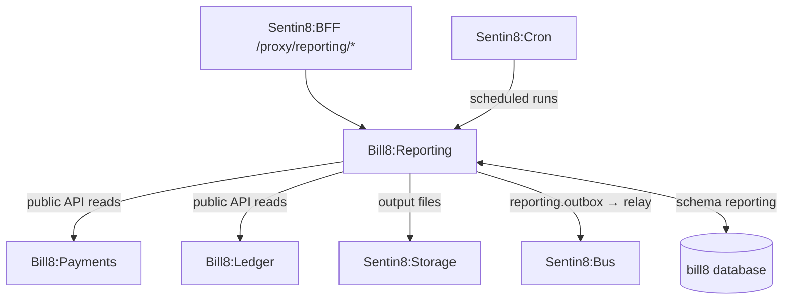
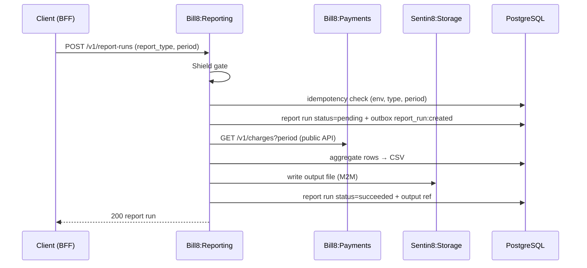
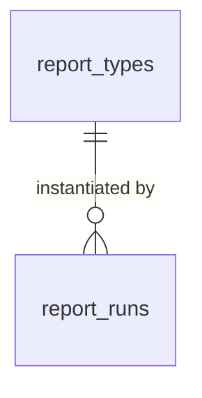
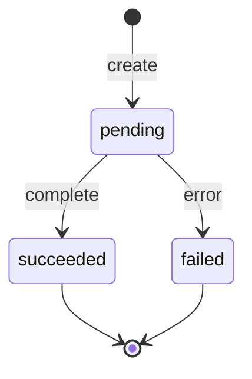
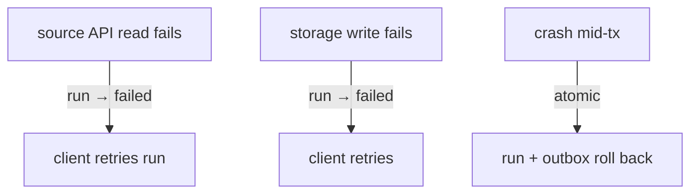
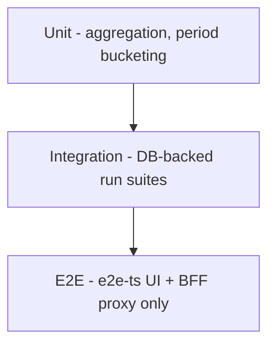

# Bill8:Reporting - Detailed Design Document

## 1. Scope & Context

Bill8:Reporting owns: the reporting domain schema (domain tables +
the leaf schema `reporting` for outbox/audit journal), the report-type /
report-run REST API, the scheduled-report proxy-back handler for
Sentin8:Cron, and the `bill8:reporting:*` event family.

It does NOT own: the underlying data (reports read via public APIs of
the owning services), object storage (Sentin8:Storage holds output
files), or scheduling (Sentin8:Cron).

## 2. Runtime Architecture

Shell-booted; `build_state` adds config, Bus client, AppState.

**Report run lifecycle**:

## 3. Data Model

| Table | Purpose |
|---|---|
| `report_types` | Versioned report definitions |
| `report_runs` | Executions with status + output reference |

**State machine**:

**Producer tables** (platform contracts, `reporting` leaf schema):
`reporting.outbox` (DBX producer path - architecture-principles §6.7)
and `reporting.audit_journal` (the 15-column contract of
`sentin8_audit::audit_journal_sql`, AUDJOUR-1 - env-pinned RLS, drained
to Sys `POST /v1/audit` by the shell's boot-8c pusher).

## 4. API Surface

| Endpoint group | Prefix | Authorization | Events |
|---|---|---|---|
| Report types | `/v1/report-types` | `bill8:reporting:types:{read,write}` | `report_type:created` |
| Report runs | `/v1/report-runs` | `bill8:reporting:runs:{read,write}` | `report_run:created/succeeded/failed` |
| Internal | `/v1/internal/*` | M2M | - |

## 5. Cross-Cutting Concerns

- Shield-gated; `env_id` RLS.
- Certificate identity (CERTFREE-4V) (`reporting`, `reporting-policy`, `reporting-audit`,
  `reporting-storage`).
- Idempotent runs per `(env, type, period)`.
- Output files written to Storage and referenced, never inlined.

## 6. Failure Modes & Recovery

## 7. Concurrency & Performance Model

- Pool cap 3; runs are batch, not hot-path. Aggregation happens in
  memory then streams to Storage.

## 8. Invariants, Insecure-Defaults Rejected, Unsafe Rationale

- A run is idempotent per `(env_id, report_type, period)`.
- Output files referenced, never inlined in rows.
- `#![forbid(unsafe_code)]`.

## 9. Testing Strategy

## 10. Open Questions

- See `backlog.md` `RPT-*`.

---

**Architecture & Design:** bill8:reporting and its underlying concepts were designed by [Hamid Jahanzad](https://www.linkedin.com/in/hamidjahanzad/).

