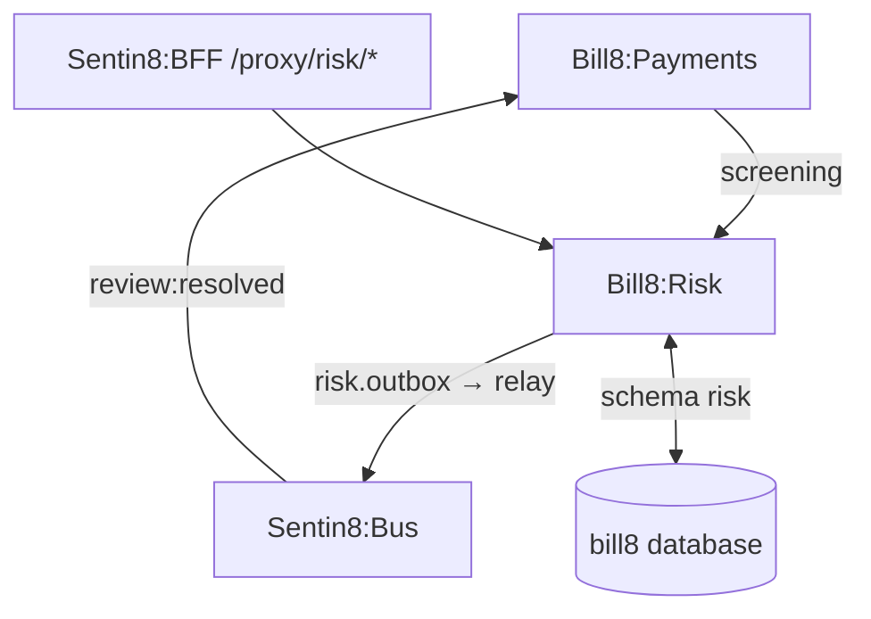
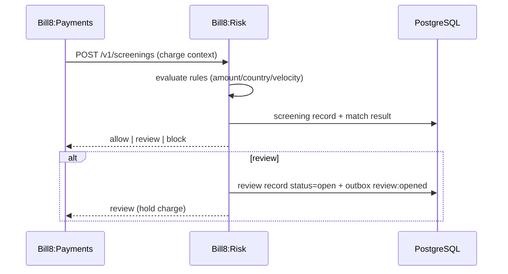
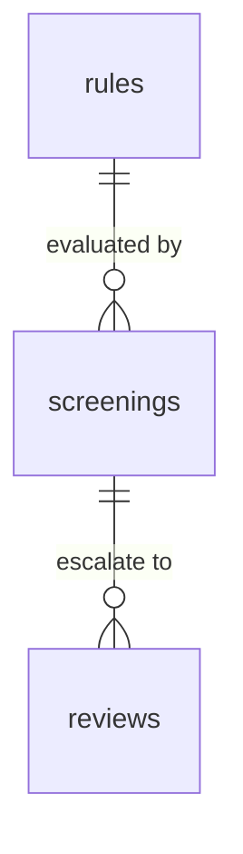
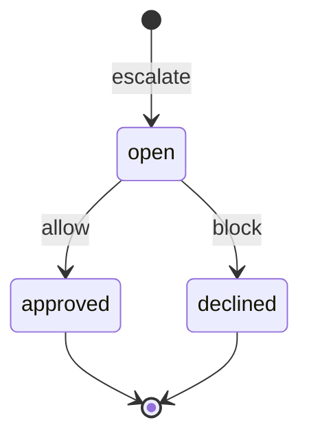
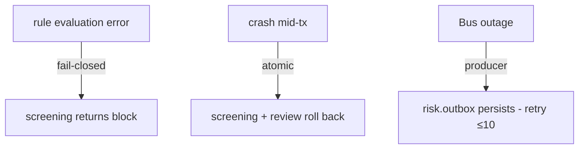
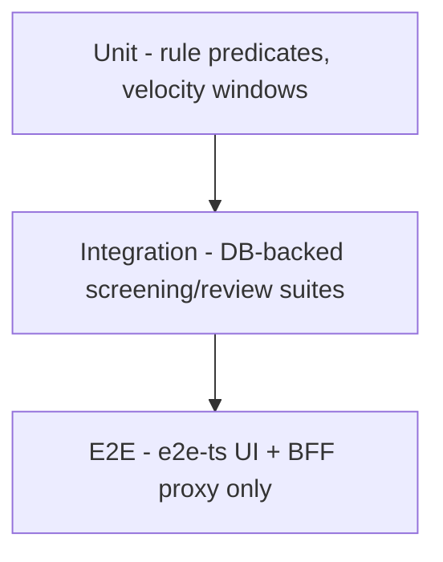

# Bill8:Risk - Detailed Design Document

## 1. Scope & Context

Bill8:Risk owns: the risk domain schema (domain tables + the leaf
schema `risk` for outbox/audit journal), the rule / review / screening
REST API, the inline screening handler invoked by payments, and the
`bill8:risk:*` event family.

It does NOT own: payment execution (Bill8:Payments), or money
movement (Bill8:Ledger).

## 2. Runtime Architecture

Shell-booted; `build_state` adds config, Bus client, AppState.

**Screening (inline, called by payments)**:

## 3. Data Model

| Table | Purpose |
|---|---|
| `rules` | Declarative predicates + actions |
| `screenings` | Evaluation results (auditable) |
| `reviews` | Manual adjudication queue |

**Review state machine**:

**Producer tables** (platform contracts, `risk` leaf schema):
`risk.outbox` (DBX producer path - architecture-principles §6.7) and
`risk.audit_journal` (the 15-column contract of
`sentin8_audit:: audit_journal_sql` - env-pinned RLS, drained
to Sys `POST /v1/audit` by the shell's boot-8c pusher).

## 4. API Surface

| Endpoint group | Prefix | Authorization | Events |
|---|---|---|---|
| Rules | `/v1/rules` | `bill8:risk:rules:{read,write}` | `rule:created/updated` |
| Screenings | `/v1/screenings` | `bill8:risk:screenings:read` (write is M2M) | `screening:created` |
| Reviews | `/v1/reviews` | `bill8:risk:reviews:{read,write}` | `review:opened/resolved` |
| Internal | `/v1/internal/*` | M2M | - |

## 5. Cross-Cutting Concerns

- Shield-gated; `env_id` RLS.
- Certificate identity (CERTFREE-4V) (`risk`, `risk-policy`, `risk-audit`).
- Screening fail-closed (deny on evaluation error).
- Review resolution idempotent.

## 6. Failure Modes & Recovery

## 7. Concurrency & Performance Model

- Pool cap 3; screening is on the payments hot path - evaluation is
  in-memory and pure (no row locks), results persisted best-effort.

## 8. Invariants, Insecure-Defaults Rejected, Unsafe Rationale

- A rule's action is applied before the charge commits.
- Screening fails closed on evaluation error.
- `#![forbid(unsafe_code)]`.

## 9. Testing Strategy

## 10. Open Questions

- See `backlog.md` `RSK-*`.

---

**Architecture & Design:** bill8:risk and its underlying concepts were designed by [Hamid Jahanzad](https://www.linkedin.com/in/hamidjahanzad/).

